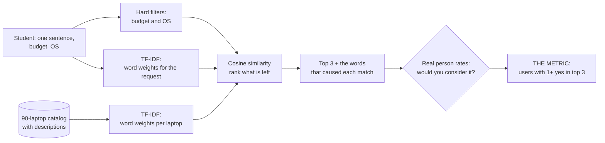
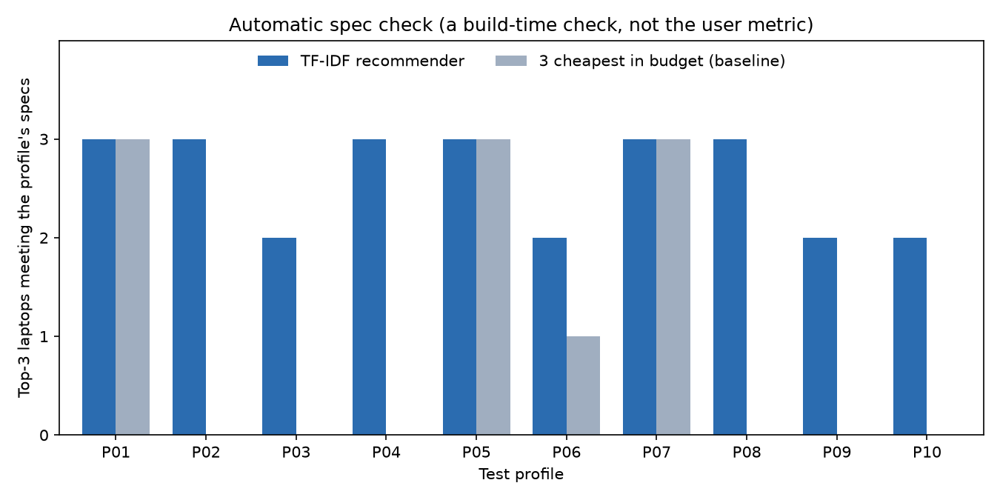

# Scoped Recommender: picking a student laptop, scoped like a product

> **Status: in progress.** Working code is here; the step still open is listed under the status or results section below.


A small recommender that suggests 3 laptops to a student from one sentence about
what they need, a budget and an operating system. The point of the project is
the product scoping: who it serves, the one metric that decides if it works,
what is left out, and why generative AI was ruled out before any code was
written. The scope came first and is in [SCOPE.md](SCOPE.md) (first commit).

> **Data note.** The 90-laptop catalog in `data/laptops.csv` is **illustrative
> data written on 2026-10-20 from general knowledge, not scraped or downloaded.**
> Prices, weights and battery figures are approximate and must be checked
> against the manufacturers before anyone uses this to buy a laptop.

## The problem

Students pick laptops by price or by asking a friend. Neither looks at what they
said they need. The question: can plain word-matching against short product
descriptions put a laptop the student would actually consider in the top 3?

## How it works



- **Hard filters first.** Budget and operating system are never traded off.
- **TF-IDF ranks the rest.** Rare, specific words ("cuda", "stylus", "number
  pad") count more than common ones ("laptop").
- **Every match explains itself** with the words it shared with the request.
- **Baseline:** the 3 cheapest laptops in budget, which is what most students do.

## Results so far (real numbers from `python run.py`, 2026-10-20)

**The metric that counts, top-3 relevance rated by real users: not done yet.** No one has
rated the lists yet. The rating sheet is `ratings/ratings.csv`. Target: 7 of 10.

The supporting build-time check (does each laptop meet the hard specs written
into the profile, such as "under 3 lb" or "has a GPU"; the recommender never
sees these columns):

| | TF-IDF recommender | 3 cheapest (baseline) |
|---|---|---|
| Top-3 laptops passing the spec check | **26 of 30** | 10 of 30 |
| Profiles with at least 1 passing laptop | **10 of 10** | 4 of 10 |



**Where it failed, and why** (these are the interesting part):

- **P06 film student:** rank 1 was an 8 GB MacBook Air M1. The request said
  "mac" and "edit video"; the descriptions say "video editing". TF-IDF treats
  "edit" and "editing" as different words, so the only strong match was "mac".
- **P09 engineering student:** rank 3 had no GPU and matched only the word "run".
- **P10 vague request** ("something reliable for school"): the only shared word
  was "school", so the ranking is close to luck. A follow-up question would help
  more than a smarter model.

**Read these numbers with care.** I wrote the catalog, the profiles and the spec
check, so the spec check partly measures how well my descriptions match my own
profiles. That is exactly why the real metric is ratings from other people.

Agent-drafted verdicts for each profile sit in
`ratings/agent_placeholder_verdicts.csv`, every one marked PLACEHOLDER. They are
not results.

## Run it

```bash
pip install -r requirements.txt
python run.py          # writes results/ and a blank ratings/ratings.csv
python -m pytest -q    # 7 tests: budget, OS, only real rows, explanations
```

After people fill `ratings/ratings.csv` (one row per laptop, yes or no), run
`python run.py` again and it prints the metric.

## Files

| File | What it is |
|---|---|
| `SCOPE.md` | The one-page scope, written before the code |
| `recommender.py` | TF-IDF model, filters, baseline, spec check |
| `run.py` | Runs everything with one command |
| `data/laptops.csv` | 90 illustrative laptops |
| `data/profiles.csv` | 10 test profiles |
| `results/` | Recommendations, spec-check table, chart |
| `ratings/` | Blank rating sheet and the placeholder verdicts |

## What I would do next

1. Get 10 real ratings, then report the number whatever it is.
2. Add stemming so "edit" matches "editing" (fixes P06), and test whether it
   moves the metric.
3. Ask one follow-up question when a request shares fewer than 2 words with the
   catalog (fixes P10).
4. Replace the illustrative catalog with verified specs and prices.
